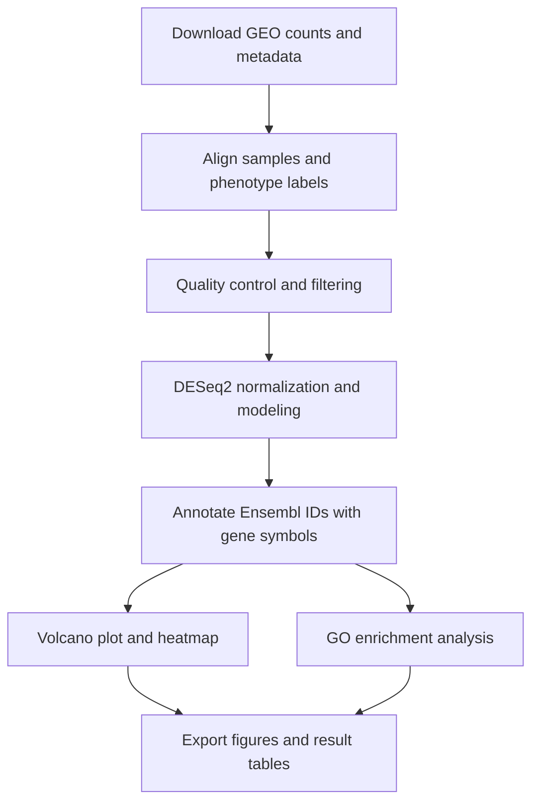

# COVID-19 Differential Expression Analysis
This project is an R/Bioconductor workflow for the purpose of identifying gene-expression changes in peripheral blood mononuclear cells (PBMCs) from individuals with COVID-19 compared with healthy (as in uninfected by COVID-19) controls.

Through this project, I reanalyzed publicly available bulk RNA-seq count data from GEO accession GSE152418. The workflow covers data acquisition, quality control, differential expression analysis with DESeq2, gene annotation, visualization, and Gene Ontology (GO) enrichment analysis.

## Objectives
The goal of this project was to identify the genes and pathways that are altered in COVID-19 patients compared with healthy controls. I did this by:
-Building a reproducible RNA-seq analysis workflow in R.
-Comparing gene expression between COVID-19 samples and healthy controls.
-Identifying genes that demonstrate statistically significant and biologically meaningful expression changes.
-Converting Ensembl gene identifiers to human-readable gene symbols while maintaining the original identifiers.
-Exploring biological processes represented among the differentially expressed genes.
-Communicating the workflow, results, and limitations here.

## Dataset
GEO accession GSE152418 contains bulk RNA-seq data generated from human PBMCs using the Illumina NovaSeq 6000 platform. The downloaded count matrix contained 60,683 features across 35 columns, including the gene-identifier column.

The associated sample metadata included:
| Header 1 | Header 2 |
| -------- | -------- |
| COVID-19 | 16 |
| Healthy | 17 |
| Convalescent | 1 |

The differential expression comparison in this project only uses the 16 COVID-19 samples and 17 healthy controls. The single convalescent sample is excluded because it does not provide sufficient replication for a separate group comparison (n = 1).

The original GEO study describes RNA-seq profiling of PBMCs from 17 COVID-19 subjects and 17 healthy controls. In the metadata used here, one subject is labeled convalescent; this project preserves that label and documents its exclusion from the primary comparison.

## Workflow


## Progress
✓ Downloaded GEO data
✓ Parsed count matrix
✓ Built metadata
✓ Filtered genes
✓ Ran DESeq2
✓ Generated PCA

## Results

## Repository Structure

```text
covid19-rnaseq-deseq2/

├── README.md
├── LICENSE
├── .gitignore
├── renv.lock
│
├── data/
│   ├── raw/
│   └── processed/
│
├── scripts/
│   ├── 01_download_data.R
│   ├── 02_qc_and_preprocessing.R
│   ├── 03_deseq2_analysis.R
│   ├── 04_visualization.R
│   └── 05_enrichment_analysis.R
│
├── figures/
│
├── results/
│
├── report/
│   └── covid_analysis.Rmd
│
└── docs/
    └── dataset_notes.md
```

## Reproducibility

```r
renv::restore()
