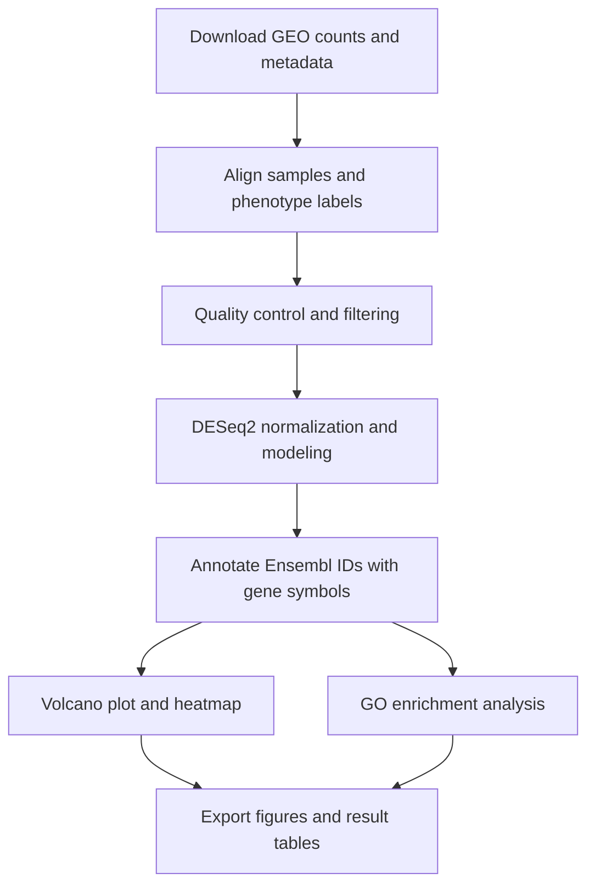
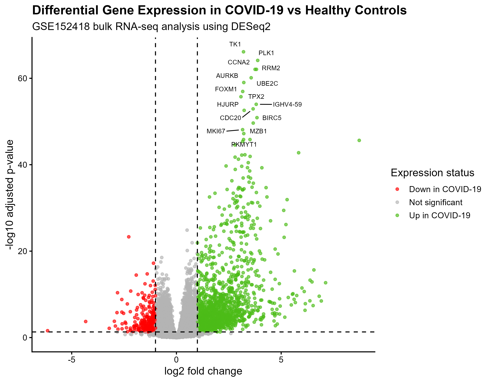
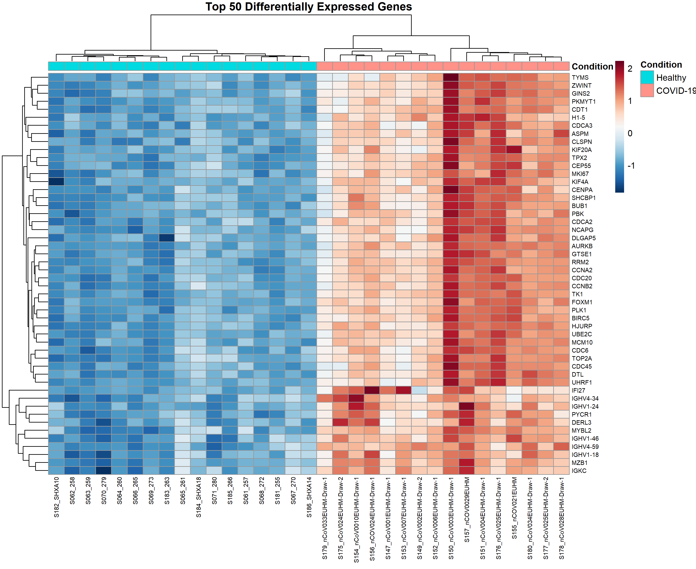
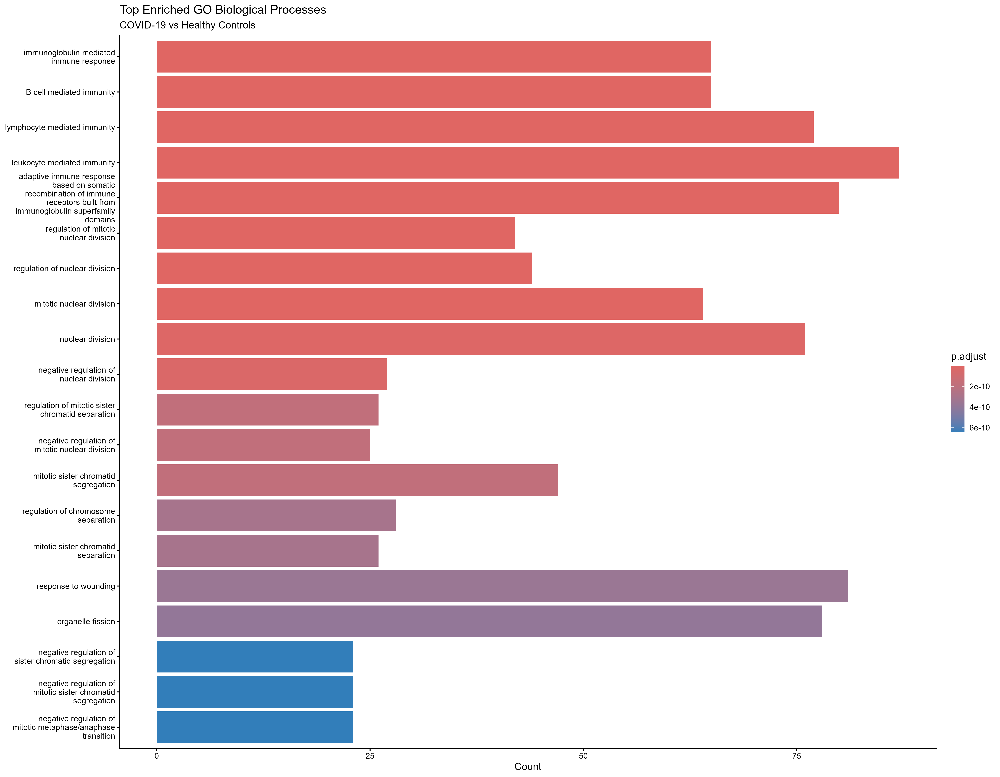

# COVID-19 Differential Expression Analysis
This project is an R/Bioconductor workflow for the purpose of identifying gene-expression changes in peripheral blood mononuclear cells (PBMCs) from individuals with COVID-19 compared with healthy (as in uninfected by COVID-19) controls.

Through this project, I reanalyzed publicly available bulk RNA-seq count data from GEO accession GSE152418. The workflow covers data acquisition, quality control, differential expression analysis with DESeq2, gene annotation, visualization, and Gene Ontology (GO) enrichment analysis.

## Objectives
The goal of this project was to identify the genes and pathways that are altered in COVID-19 patients compared with healthy controls. I did this by:
- Building a reproducible RNA-seq analysis workflow in R.
- Comparing gene expression between COVID-19 samples and healthy controls.
- Identifying genes that demonstrate statistically significant and biologically meaningful expression changes.
- Converting Ensembl gene identifiers to human-readable gene symbols while maintaining the original identifiers.
- Exploring biological processes represented among the differentially expressed genes.
- Communicating the workflow, results, and limitations here.

## Dataset
GEO accession GSE152418 contains bulk RNA-seq data generated from human PBMCs using the Illumina NovaSeq 6000 platform. The downloaded count matrix contained 60,683 features across 35 columns, including the gene-identifier column.

The associated sample metadata included:
| Disease State | Samples |
| -------- | -------- |
| COVID-19 | 16 |
| Healthy | 17 |
| Convalescent | 1 |

The differential expression comparison in this project only uses the 16 COVID-19 samples and 17 healthy controls. The single convalescent sample is excluded because it does not provide sufficient replication for a separate group comparison (n = 1).

The original GEO study describes RNA-seq profiling of PBMCs from 17 COVID-19 subjects and 17 healthy controls. In the metadata used here, one subject is labeled convalescent. This project preserves that label and documents its exclusion from the primary comparison.

## Workflow


## 1. Data acquisition and preparation
- Raw counts and sample metadata for GSE152418 were downloaded from GEO.
- Count-matrix column names were matched to sample titles.
- Counts and metadata were checked for any missing, duplicated, or unmatched samples.
- Convalescent sample was removed from the COVID-19 versus healthy comparison.

## 2. Quality Control
- Library sizes and count distributions were examined.
- Genes with no informative counts were removed.
- A variance-stabilizing transformation was applied for sample-level visualization.
- Sample relationships were evaluated before interpreting differential expression results.

## 3. Differential expression

Differential expression was modeled in DESeq2 using "disease state" as the variable of interest:
design = ~ disease_state

A gene was considered significant in the focused result set when it met both criteria:
- Benjamini-Hochberg adjusted p-value (padj) < 0.05
- Absolute log2 fold change (|log2FoldChange|) > 1

Positive log2 fold changes indicated higher expression in COVID-19 samples compared to healthy controls, whereas negative values indicated lower expression.

## 4. Gene annotation

Ensembl identifiers were mapped to gene symbols with AnnotationDbi and org.Hs.eg.db. Version suffixes were removed before mapping when necessary. The original Ensembl identifier was retained in exported tables so that annotations would remain traceable.

Gene symbols were used for:
- Labels on the volcano plot
- Row names in the heatmap
- Readable gene names in result summaries

For missing or duplicated symbols, the workflow fell back to an Ensembl identifier so that rows would remain unique and no result would be silently discarded.

## 5. Functional enrichment

Significant genes were evaluated with a GO enrichment analysis to identify overrepresented biological processes. Enrichment results were intended to generate biological hypotheses, not to establish causal mechanisms.

## Results

DESeq2 tested 18,796 genes with non-zero total read counts. At an adjusted p-value threshold of 0.10, the full DESeq2 summary reported the following results:
| Result category | Genes | Percentage |
| ------ | ------ | ------|
| Higher expression in COVID | 4,720 | 25% |
| Lower expression in COVID | 3,830 | 20% |
| Outliers | 0 | 0% |
| Low-count genes removed by independent filtering | 0 | 0% |

Applying the more stringent project threshold of padj < 0.05 and |log2FoldChange| > 1 identified 1,879 differentially expressed genes.

The exported differential-expression table contains the complete ranked results, including:
- Ensembl ID;
- Gene symbol
- Mean normalized expression
- log2 fold change
- Standard error
- Wald test statistic
- Raw p-value
- Adjusted p-value.

## Visualizations

The analysis produced:
- A volcano plot showing statistical significance and effect size:

- A heatmap of the 50 most significant differentially expressed genes:

- And a GO enrichment plot summarizing overrepresented biological processes:


## Repository Structure

```text
covid19-rnaseq-deseq2/

├── README.md
├── LICENSE
├── .gitignore
├── renv.lock
│
├── data/
│   ├── raw/
│   └── processed/
│
├── scripts/
│   ├── 01_download_data.R
│   ├── 02_qc_and_preprocessing.R
│   ├── 03_deseq2_analysis.R
│   ├── 04_volcano_plot.R
│   └── 05_heatmap_top50.R
│   └── 06_go_enrichment_analysis.R
│   └── 07_final_results.R
│
├── figures/
│   ├── go_bp_barplot.png
│   ├── go_bp_dotplot.png
│   ├── heatmap_top50.png
│   ├── pca_plot.png
│   ├── qc_boxplot.png
│   ├── volcano_plot.png
│   ├── volcano_plot_w_gene_symbols.png
│
├── results/
│
├── report/
│   └── covid_analysis.Rmd
│
└── docs/
    └── dataset_notes.md
```

## Requirements
The analysis is written in R and uses packages from CRAN and Bioconductor, including:
- GEOquery
- DESeq2
- AnnotationDbi
- org.Hs.eg.db
- ggplot2
- pheatmap
- clusterProfiler
- dplyr
- tibble
- readr

Package versions can be restored from renv.lock.

## To reproduce this analysis
1. Clone this repository:
```
git clone https://github.com/coneill650/covid19-rnaseq-deseq2.git
cd covid19-rnaseq-deseq2
```
2. Open R in the project directory and restore the recorded environment:
```
install.packages("renv")
renv::restore()
```
3. Run these scripts in numerical order:
```
source("scripts/01_download_data.R")
source("scripts/02_qc_and_preprocessing.R")
source("scripts/03_deseq2_analysis.R")
source("scripts/04_volcano_plot.R")
source("scripts/05_heatmap_top50.R")
source("scripts/06_go_enrichment_analysis.R")
source("scripts/07_final_results.R")
```

## Interpretation and limitations

## Data source and citation of original study

Data were obtained from the NCBI Gene Expression Omnibus:

[GSE152418: Systems biological assessment of immunity to severe and mild COVID-19 infections](https://www.ncbi.nlm.nih.gov/geo/query/acc.cgi?acc=GSE152418)

Original study:
Arunachalam PS, Wimmers F, Mok CKP, et al. Systems biological assessment of immunity to mild versus severe COVID-19 infection in humans. Science. 2020;369(6508):1210-1220. https://doi.org/10.1126/science.abc6261

Other references:

Please cite the original study and GEO accession when reusing the data.

## Author
Connor O'Neill

[GitHub](https://github.com/coneill650)

## License
The original code in this repository is available under the [MIT License](LICENSE).

The GSE152418 dataset is not redistributed or relicensed by this project. It remains subject to the policies and terms of the NCBI Gene Expression Omnibus and the original study. Third-party R packages remain subject to their respective licenses.
